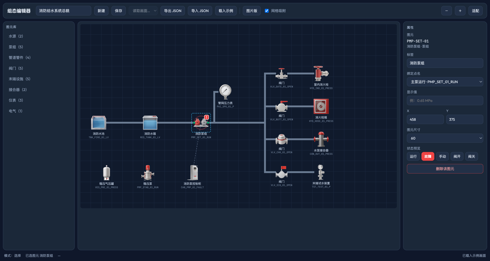

# 消防系统图元库

Web 端组态图元库，**两套并存**：

- **图片版**：扁平拟物正视实物图（512×512 PNG），给值班运维人员看，形态直观
- **线框版**：SVG 工程符号，给施工图、打印图和工程师看

47 个消防图元 / 4 个系统 / 14 个分类 / 109 个动态绑定点 / 71 个连接点，两套图元共用同一份点表与同一套绑定定义。

分类与数量：

| 一级（系统） | 二级（分类） | 图元数 |
|---|---|---|
| 消防给水 `pipeline` | 水源、泵组、末端设施、接合器 | 16 |
| 气体灭火 `gas` | 储存装置、驱动装置、灭火剂管网、探测报警、控制、辅助设施 | 18 |
| 消防防排烟 `smoke` | 预留 | 0 |
| 通用件 `common` | 管道管件、阀门、仪表、电气 | 13 |

管道管件类图元统一 2 个连接点：0 号在左（画布 x=4）、1 号在右（画布 x=60），y 均为 32。连线按左右进出，管道与支管走向一致。气体灭火图元按需取 0 / 1 / 2 / 3 口。

## 分类体系

两级分类，**分类表是分类的唯一真源**，声明在 `src/symbols.source.js`：

```js
export const SYSTEMS = [
  { key: 'pipeline', name: '消防给水', desc: '...' },
  { key: 'gas', name: '气体灭火', desc: '...' },
  { key: 'smoke', name: '消防防排烟', desc: '...' },
  { key: 'common', name: '通用件', desc: '...' },
];

export const CATEGORIES = [
  { key: '水源', system: 'pipeline', screen: 'G02 水源监控' },
  { key: '管道管件', system: 'common', screen: 'G04 管网压力' },
  // ...
];
```

规则：

- 一级分类的 key 与平台 `systemKey`（`pipeline` / `gas` / `smoke` / `custom`）同源，图元库分组与组态画面的「归属系统」用同一套词
- 图元只引用二级分类键；系统归属默认取分类的 `system`，图元可用自身 `system` 字段覆盖（`PAI-CYL-01` 分类属通用「仪表」，系统归属为气体灭火；`ALV-GRP-01` 分类属通用「阀门」，系统归属为消防给水）
- 通用件（`system: 'common'`）在所有系统视图下都可见，界面带「通用」标记
- 新增分类只改分类表，构建时校验图元引用的分类与系统必须已声明

构建产物中 `manifest.systems` 给出分类树，`manifest.categories` 给出每个分类的图元数与建议画面编号。

## 目录

```
symbol-library/
├─ src/
│  ├─ symbols.source.js   唯一真源：几何、端口、绑定、分类表
│  ├─ runtime.js          渲染与状态应用
│  ├─ symbols.css         状态色与角色样式
│  ├─ build.mjs           构建 + 入库校验
│  ├─ demo.template.html  示例组态画面模板
│  ├─ editor.template.html 组态编辑器模板
│  ├─ layouts/
│  │  ├─ demo-firewater.json  给水系统总貌（编辑器「载入示例」读取）
│  │  └─ demo-gasfire.json    气体灭火系统总貌
│  └─ react/Symbol.jsx    React 包装示例
├─ tools/
│  ├─ generate.py         位图生成（提示词在此）
│  └─ process.py          抠图 → 512×512 透明 PNG → 内容框索引
├─ assets/raw/            生成原图（不进交付包）
└─ dist/                  构建产物
   ├─ img/                图片版图元 PNG + index.json
   ├─ symbols.js          MANIFEST + GEOMETRY + GEOMETRY_IMAGE
   ├─ symbols.svg         线框版精灵图
   ├─ symbols-img.svg     图片版精灵图
   ├─ symbols.css         样式
   ├─ runtime.js          运行时
   ├─ manifest.json       元数据（含分类树）
   ├─ points.sample.csv   示例点表（109 点）
   ├─ preview.html        图元总览页，双击可打开
   ├─ demo.html           示例组态画面，双击可打开
   ├─ editor.html         组态编辑器，双击可打开
   └─ layouts/
      ├─ demo-firewater.json  给水总貌布局 JSON
      └─ demo-gasfire.json    气体灭火总貌布局 JSON
├─ docs/
   ├─ editor.png
   └─ 气体灭火图元清单.md     气体灭火系统的图元、测点与画面清单
```

## 构建

```bash
npm run build     # 生成 dist/；校验不通过时退出码 1
```

改图元改 `src/symbols.source.js`，`dist/` 全部由构建产出。

### 在本平台仓库中

本库是 `maintenance-demo` 仓库内的子工程，平台侧不直接构建本目录，统一走仓库根的脚本：

```bash
npm run symbols:build   # 构建图元库 + 同步位图到 public/symbols/img
npm run symbols:sync    # 只同步位图
npm run symbols:verify  # 校验产物、点表、布局与文档声明是否互相自洽
```

平台侧接入（vite alias `@symbols` → `symbol-library/dist`）：

```js
import { MANIFEST, GEOMETRY, GEOMETRY_IMAGE } from '@symbols/symbols.js'
import { createRuntime } from '@symbols/runtime.js'
import pointsCsv from '@symbols/points.sample.csv?raw'

const rt = createRuntime(MANIFEST, GEOMETRY, GEOMETRY_IMAGE)
const svg = rt.renderSymbol('PMP-FIRE-01', { style: 'image', size: 60, imageBase: '/symbols/img' })
```

位图服务路径 `/symbols/img/<图元ID>.png`，由 `scripts/sync-symbol-assets.mjs` 从 `dist/img/` 复制到 `public/symbols/img/`（不改运行时逻辑，只换目录）。

平台侧接入代码在 `src/symbols/`：`index.ts`（运行时单例、图元元数据、点表解析、几何计算）、`runtime.d.ts`（类型声明）、`theme.css`（`--sym-*` 改挂平台设计令牌）。

## 两套图元的差异

| | 图片版 | 线框版 |
|---|---|---|
| 载体 | PNG 位图 + SVG 叠层 | 纯 SVG |
| 状态表达 | 外圈光晕 + 右上角状态角标 | 图形本身换色 |
| 液位表达 | 图元左侧液位条（水池、水箱除外） | 容器内部液柱 |
| 指针 | 位图内固定指针，实时值走文本 | SVG 指针随模拟量旋转 |
| 体积 | 每张约 130 KB | 每图元约 1 KB |
| 适用 | 值班监控画面、触屏 | 施工图、打印图 |

两套共用 `bindings`，切换只需换 `style` 参数。

### 水源两个图元

| 图元 | 造型 |
|---|---|
| 消防水池 `TNK-FIRE-01` | 正方形混凝土外墙、敞口不封顶、正视剖面，池内盛水 |
| 消防水箱 `RES-TANK-01` | 矩形平顶箱体剖面，顶盖钢板、正视剖面，箱内盛水 |

两者位图内已含水体，图片版不再叠加液位条；液位数值仍由 `TNK_FIRE_01_LV` / `RES_TANK_01_LV` 点提供，在画面上以文本显示，线框版仍用容器内液柱随液位变化。

### 报警阀组 `ALV-GRP-01`

湿式报警阀组，分类归通用「阀门」，系统归属消防给水（`system` 字段覆盖）。管道内串联，左右各 1 口（x=4 / 60，y=32）。建议画面继承分类的 G04 管网压力。

| 绑定 | 点名 | 类型 | 状态类 / 量程 |
|---|---|---|---|
| 阀前压力 | `ALV_GRP_01_PIN` | text | 0~1.6 MPa，报警 0.14~1.2 |
| 阀后压力 | `ALV_GRP_01_POUT` | text | 0~1.6 MPa，报警 0.1~1.2 |
| 水力报警 | `ALV_GRP_01_ALM` | bool | is-alarm |
| 阀位 | `ALV_GRP_01_OPEN` | bool | is-open / is-closed |
| 故障 | `ALV_GRP_01_FAULT` | bool | is-fault |

线框版为阀体 + 阀前后压力表 + 顶部报警开关 + 底部排水阀；图片版为正视实物位图，阀体带红标识牌。

### 气体灭火 18 个图元

| 分类 | 图元 |
|---|---|
| 储存装置 | 灭火剂钢瓶组 `CYL-GRP-01`、启动气瓶 `CYL-DRV-01`、集流管 `MAN-COL-01` |
| 驱动装置 | 启动电磁阀 `VLV-SOL-01`、手动启动拉环 `MAN-PUL-01`、压力信号器 `PRS-SIG-01`、延时继电器 `RLY-DLY-01` |
| 灭火剂管网 | 灭火剂管道 `PIP-GAS-01`、喷嘴 `NZL-GAS-01` |
| 探测报警 | 感烟探测器 `DET-SMK-01`、感温探测器 `DET-HST-01`、声光警报器 `ALM-SLR-01`、手动报警按钮 `MAN-CLB-01` |
| 控制 | 气体灭火控制器 `CTL-GAS-01`、输入输出模块 `MDL-IOR-01` |
| 辅助设施 | 泄压口 `VNT-REL-01`、排风机 `FAN-EXH-01` |
| 仪表 | 钢瓶压力表 `PAI-CYL-01` |

完整清单（几何要点、端口、绑定、点表、画面落位）见 `docs/气体灭火图元清单.md`。

两点与给水图元不同：

- 钢瓶压力用 `text` 绑定显示数值，不用液柱表达——压力不是液位，且 `level` 绑定在运行时只认单个 `.sym-liquid` 元素，三瓶并列放不下
- 这批图元引入 `is-alarm`（报警）与 `is-discharge`（已喷放）两个状态类，与给水图的「运行 / 故障 / 手动」语义分开

## 示例组态画面

`dist/demo.html` 是用本图元库拼出的消防给水总貌画面，自包含，双击即可打开。

画面包含：消防水池 → 消防水箱 → 消防泵组 + 消防泵控制柜 → 管网压力表 → 竖向管网 → 4 条支管（阀门 + 室内消火栓 / 消火栓箱 / 水泵接合器 / 末端试水装置），左下角为稳压泵与稳压气压罐，控制柜与泵组之间有虚线电气连接。

| 区域 | 内容 |
|---|---|
| 顶栏 | 画面导航、时钟、火警横幅 |
| 主画面 | 给水流程总貌，管段带流向虚线，图元下显示点名与实时值 |
| 右侧 | 实时数据（液位/压力/流量）、操作按钮、实时报警（可逐条确认） |
| 底部 | 泵出口压力 / 管网压力 / 末端流量趋势曲线 |

可操作项：启动主泵、停止主泵、切备用泵、转手动、开/关总阀、模拟火警（自动联动启泵并推送一级报警）、复位报警。数据为前端仿真，1 秒一拍。

`src/layouts/demo-gasfire.json` 是气体灭火系统总貌布局：1400×920，69 节点 / 37 连线。左侧为控制列（控制器、输入输出模块、延时继电器、压力信号器、手动启动拉环、控制柜），中部 4 个保护区各一套独立回路（启动气瓶 → 启动电磁阀 → 灭火剂钢瓶组 → 集流管 → 灭火剂主管 → 支管阀 → 喷嘴），每个保护区上方挂探测器、声光警报器、手动报警按钮，下方挂泄压口与排风机，底部是联动流程条（探测 → 声光 → 延时 0~10s → 启动 → 喷放反馈 → 喷嘴喷放）。

## 组态编辑器

`dist/editor.html` 是本图元库配套的组态编辑器，双击即可打开，自包含、无需服务端。



### 能做什么

| 能力 | 操作 |
|---|---|
| 放置图元 | 点左侧图元库缩略图 → 画布上点击放置；Esc 取消 |
| 移动图元 | 在画布上拖动图元 |
| 连线 | 选中图元后拖动绿色连接点到目标图元的连接点 |
| 改属性 | 选中后在右侧属性面板改标签、绑定点名、显示值、X/Y、尺寸、状态 |
| 尺寸档位 | 40 / 48 / 60 / 72 / 96 |
| 删除 | Delete 键，或属性面板的「删除该图元」「删除该连线」 |
| 折点 | 属性面板「折点」填 `x,y \| x,y`，连线按折点走正交路径 |
| 存草稿 | 每次改动自动写入 localStorage，刷新不丢 |
| 命名保存 | 「保存」存入命名布局集合，可继续编辑 |
| 导入导出 | 「导出 JSON」/「导入 JSON」 |
| 载入示例 | 「载入示例」载入示例画面（内容来自 `src/layouts/demo-firewater.json`，构建期内联进页面） |
| 风格切换 | 「图片版」/「线框版」一键切换，布局不变 |
| 网格吸附 | 拖动时按 8 px 网格对齐 |
| 画布尺寸 | 跟随画面的 `width` / `height`（缺省 1200×700）；载入示例、读取画面、导入 JSON 时同步切换，导出 JSON 带上尺寸 |

### 界面结构

- 左栏：图元库，一级为系统切换标签（全部 / 消防给水 / 气体灭火 / 消防防排烟 / 通用件），二级为分类折叠，每项带缩略图、ID、名称；顶部可按名称 / ID / 说明搜索
- 中间：画布，支持缩放（－/＋）与「适配」；画布尺寸随画面 `width` / `height`
- 右栏：属性面板 + 状态预览
- 顶栏：新建、保存、读取画面下拉、导出 JSON、导入 JSON、载入示例、图片版/线框版、网格吸附开关、缩放、适配

### 布局数据格式

编辑器和外部系统之间只交换这一份 JSON：

```json
{
  "version": 1,
  "name": "消防给水系统总貌",
  "nodes": [
    { "id": "n1", "symbol": "TNK-FIRE-01", "x": 70, "y": 375, "size": 60,
      "label": "消防水池", "point": "TNK_FIRE_01_LV", "value": "2.40 m",
      "state": { "run": true, "fault": false } }
  ],
  "edges": [
    { "id": "e1", "from": { "node": "n1", "port": 1 }, "to": { "node": "n2", "port": 0 },
      "via": [[200, 375]], "kind": "pipe" }
  ]
}
```

| 字段 | 说明 |
|---|---|
| `nodes[].symbol` | 图元 ID，取值见 `dist/manifest.json` |
| `nodes[].x` / `y` | 画布坐标，图元中心 |
| `nodes[].size` | 图元边长，40/48/60/72/96 |
| `nodes[].point` | 绑定点名，可从点表下拉选取 |
| `nodes[].value` | 显示值文本 |
| `nodes[].state` | 状态标志对象，键为 `run`/`fault`/`manual`/`open`/`closed`/`off`，值为布尔 |
| `edges[].from/to` | 起止节点 ID 与连接点序号（0=左，1=右）；`kind=control` 的电气连线不经过端口，两端只写 `node` |
| `edges[].via` | 折点坐标数组，可省略 |
| `edges[].kind` | `pipe` 管道连线 / `control` 电气虚线 |

`state` 的键映射到 CSS 状态类：`run`→`is-run`、`fault`→`is-fault`、`manual`→`is-manual`、`open`→`is-open`、`closed`→`is-closed`、`off`→`is-off`（仅在无其他状态时生效）。

连线端点由端口序号定位，端口定义在 `src/symbols.source.js` 的 `ports` 字段。

### 接到真实系统

编辑器导出的 JSON 可直接被自建的画面加载：

```js
const layout = await (await fetch('my-layout.json')).json();
// 逐个节点渲染图元、逐条边画连线，实现见 dist/editor.html 的 render()
```

`state` 与 `value` 是静态占位；接实时数据时用 `runtime.applyData(svg, { 点名: 值 })` 覆盖。

## 图元规范

| 项 | 规定 |
|---|---|
| 画布 / 锚点 | 64×64 px / (32,32) |
| 网格 | 8 px |
| 线宽 | 轮廓 2、管道 8、细节 1 |
| 命名 | `类别-对象-序号`，如 `PMP-FIRE-01`、`VLV-GATE-01` |
| 颜色 | 几何内不含 fill/stroke，颜色全部由 CSS 变量驱动 |
| 图片版位图 | 512×512 透明 PNG，等比缩放贴到 496×496 居中 |

### 状态色

| 类名 | 含义 | 线框版 | 图片版 |
|---|---|---|---|
| `is-run` | 运行 | 绿填充 | 绿色光晕 + ▶ 角标 |
| `is-off` | 停机 / 备用 | 灰填充 | 灰色光晕 |
| `is-fault` | 故障 | 红填充 + 闪烁 | 红色光晕 + ! 角标 |
| `is-alarm` | 报警 | 橙填充 | 橙色光晕 + 三角角标 |
| `is-discharge` | 已喷放 | 深红填充 + 闪烁 | 深红光晕 + 喷射角标 |
| `is-manual` | 手动 | 黄填充 | 黄色光晕 + M 角标 |
| `is-open` | 阀开 | 绿填充 | 绿色光晕 |
| `is-closed` | 阀关 | 灰填充 | 灰色光晕 |
| `is-over` | 溢流 / 超高 | 液位红 | 红色光晕 |
| `is-flow` | 过流 | 管段蓝 | 蓝色光晕 |

### 绑定类型

| kind | 用途 | 必填 | 效果 |
|---|---|---|---|
| `bool` | 状态量 | `point`、`onClass`/`offClass` | 根元素加状态类；可加 `spin` 让叶轮旋转（线框版） |
| `level` | 液位等模拟量 | `point`、`min`、`max`、`bottom`、`maxH` | 改变液位柱高度；`img` 字段可单独指定图片版几何 |
| `angle` | 表盘指针 | `point`、`min`、`max`、`minAngle`、`maxAngle` | 旋转 `.sym-needle` |
| `text` | 数值显示 | `point`、`unit` | 写入文本层 |

## 使用

### 原生 JS

```js
import { runtime } from './dist/runtime.js';
import './dist/symbols.css';

// style 可选 'image'（默认 'line'）
const svg = runtime.renderSymbol('PMP-FIRE-01', { style: 'image', size: 64, label: '1# 消防泵' });
document.querySelector('#canvas').appendChild(svg);

// 按点名赋值
runtime.applyData(svg, { PMP_FIRE_01_RUN: 1, PMP_FIRE_01_PRESS: 0.35 });

// 按绑定名赋值
runtime.applyState(svg, { 运行: true, 故障: false });
```

图片版位图路径默认相对当前页面 `img/`，用 `imageBase` 指定：

```js
runtime.renderSymbol('PMP-FIRE-01', { style: 'image', imageBase: '/assets/symbols' });
```

### SVG 精灵图

```html
<!-- 线框版 -->
<svg><use href="dist/symbols.svg#PMP-FIRE-01" width="64" height="64"/></svg>

<!-- 图片版，img/ 目录须与精灵图同级 -->
<svg><use href="dist/symbols-img.svg#PMP-FIRE-01" width="64" height="64"/></svg>
```

外部精灵图无法绑定动态状态（浏览器对 `<use>` 影子树的限制），状态色与角标不生效；带状态的画面用内联 SVG。

### React

见 `src/react/Symbol.jsx`：

```jsx
<Symbol id="PMP-FIRE-01" style="image" label="1# 消防泵" data={{ PMP_FIRE_01_RUN: 1 }} size={48} />
```

该文件是示例，未纳入构建脚本，也未在本机运行验证。

## 点表

`dist/points.sample.csv` 由绑定自动生成，列：点名、图元ID、图元名称、**系统**、分类、绑定、数据类型、寄存器、读写、量程、单位、报警上下限、死区、延时、画面、说明（共 18 列）。

- 点名规则：`图元ID` 下划线化 + 语义，如 `PMP_FIRE_01_RUN`
- 「系统」列取一级分类名（消防给水 / 气体灭火 / 消防防排烟 / 通用件）
- AI → `3x####`，DI → `1x####`，寄存器号按出现顺序分配，现场按实际协议改写
- 报警限值为示例值，须按现场整定
- 远程启停点需改为可写并加权限与二次确认
- 多实例场景（同一图元多个保护区）按 `图元前缀_实例号_参数` 展开，见 `docs/气体灭火图元清单.md`

## 位图生成流程

```bash
python3 tools/generate.py                     # 全部 47 张，原始图落到 assets/raw/
python3 tools/generate.py VLV-GATE-01         # 只重生成某一张
python3 tools/process.py                      # 抠图 + 归一化，产出 dist/img/
npm run build
```

- 生成走 `mcode-tools` 文生图，纯白影棚背景，提示词要求物体悬浮、无地面无投影
- 抠图分五步：
  1. 从四周边缘环取 90 分位估计影棚背景亮度（部分生成图背景不是纯白，实测最亮仅 246，固定阈值 247 会导致整块白底残留）
  2. 泛洪找出与边缘连通的背景像素，要求亮度高于背景阈值且局部平坦，避免渗进金属高光
  3. 把背景铺平成纯白后按 247 硬切，得到干净轮廓
  4. 剔除脱离主体、明显偏暗的连通块（影棚地面投影残留）
  5. 反预乘还原边缘颜色，消除白边
- 物体本身接近白色时（浅灰管道），背景阈值必须高于物体亮度，否则泛洪会吃掉物体；这类图元在 `tools/process.py` 的 `THRESHOLD` 表里单独指定
- 归一化：裁到内容框，等比缩放到 496×496 放进 512×512
- `dist/img/index.json` 记录每张图的内容框，构建时据此自动生成光晕椭圆
- 提示词与风格全部写在 `tools/generate.py`，改风格只改那里

已知的模型偏差：

- 管件类（弯头/三通/渐缩段）容易被画成泵，提示词需强调形状并排除 pump/motor
- 压力表、流量计容易被加红底板，需要去掉"消防红点缀"
- 部分设备会被画在影棚地面上，底部留下地面反光，需要在提示词里排除 ground/floor/shadow

## 新增图元

1. 在 `src/symbols.source.js` 增加一项：`id`、`name`、`category`、`system`（可选，覆盖分类默认）、`ports`、`bindings`、`shapes`
2. `shapes` 只写形状与 `role`，不写颜色
3. 若要用到新分类，先在 `SYSTEMS` / `CATEGORIES` 中声明
4. 在 `tools/generate.py` 增加同名提示词并出图，`python3 tools/process.py` 抠图
5. `npm run build`，校验通过后 `dist/` 自动更新
6. 在 `dist/preview.html` 核对渲染与状态效果

### 两种情况

- **只要线框**：在 `src/symbols.source.js` 加 `shapes` 即可，构建后直接可用
- **要图片版**：还需在 `tools/generate.py` 加提示词并出图，`python3 tools/process.py` 抠图后再构建；缺图时该图元自动退化为线框版

## 平台内新增图元（自定义图元）

上一节的「新增图元」是构建期入库，产物即内置图元，只读、不可删。平台侧另有一条运行时通道：
图元管理页（`/device-facility/rule/symbol-library`）可新增自定义图元，不重建图元库。

| 项 | 位置 |
|---|---|
| 元数据 | 服务端 Prisma `CustomSymbol` 表 |
| 产品图 | OSS（`POST /api/upload/image`，folder `symbols`） |
| 图片加工 | 浏览器端 `src/utils/symbol-image.ts`（抠背景 → 512×512 → 内容框 bbox） |
| 接口 | `GET/POST/PUT/DELETE /api/symbols/custom` |
| 渲染接入 | `src/symbols/index.ts` 的 `registerCustomSymbol` / `unregisterCustomSymbol` |

### 运行时叠加机制

注册一个自定义图元时，同时写进六处，渲染链路与内置图元完全一致：

```ts
GEOMETRY_IMAGE[id] = 图片版 markup   // 光晕 + <image> + 状态角标
GEOMETRY[id]      = 线框版占位       // 自定义图元只有产品图
DEF_MAP.set(id, def)                 // symbolDef(id) 查询
symbolRuntime.defs.set(id, def)      // 运行时按 ID 取定义
SYMBOLS.push(def)                    // 响应式数组，图元管理页 / 选择器据此渲染
SYMBOL_POINTS.push(...点表行)         // 属性面板可选点名
```

两个约定：

- **图片 markup 不写 `data-file`**。`runtime.js` 只在存在 `data-file` 时才把 `href` 拼成
  `imageBase/xxx`，省略后 `href` 保留产品图公网地址，不受静态目录 `/symbols/img` 约束。
- **状态角标复用 `BADGES`**。角标 markup 由 `build.mjs` 导出为常量，平台侧不复制第二份。

### 异步注册与重绘

自定义图元是**拉取后**才注册进渲染链路，页面首帧可能先于注册完成。图元库 runtime 对未知图元
直接抛错，而 Vue 挂载钩子抛错会中断整条 post-flush 队列，导致同批次的其他缩略图 / 画布节点
一起不渲染。平台侧因此加了两层保护：

- `src/symbols/index.ts` 的 `renderSymbolSafe()` 取代直接调用 `symbolRuntime.renderSymbol()`，
  未知图元返回 `null` 而不是抛错。
- `SYMBOL_REGISTRY_VERSION` 在每次注册 / 注销时自增，`SymbolThumb` 与 `SceneSymbolNode`
  监听它，图元就位后重绘。

图元库选择器（`SymbolPicker`）自持 `store.load()`，组态编辑器直接刷新进入时也能拿到自定义图元，
不必先经过图元管理页。

### 与内置图元的差异

| | 内置图元 | 自定义图元 |
|---|---|---|
| 真源 | `src/symbols.source.js` | 服务端 Prisma |
| 可用风格 | 线框 + 图片 | 仅图片（线框版为占位） |
| 绑定类型 | bool / level / angle / text | bool / level / text（无指针几何，不开放 angle） |
| 删除 | 不可删 | 可删，删除前查引用 |

### 删除前的引用检查

组态画面存在浏览器本地（localStorage 键 `db:scene-config`），服务端不知道谁引用了图元，
引用统计必须在前端做：删除时扫全部画面的 `nodes[].symbol`，命中则二次确认并列出画面名；
确认后把命中的节点与相关连线从画面记录和草稿中一并移除，避免残留节点渲染报错。

### 导出画面时的自定义图元

内置图元由图元库提供，外部系统按 ID 即可解析；自定义图元是平台内新增的，
导出画面时随 `symbols` 字段携带所用到的自定义图元定义（id / name / category / system /
image / ports / bindings），外部系统据此渲染。

## 校验规则

构建时自动检查，不通过则退出码 1：

- 图元 ID 唯一、符合 `类别-对象-序号`
- 图元引用的分类与系统已在分类表中声明
- 分类的 `screen`（建议画面）非空
- 连接点坐标在画布内，方向取值限 `left` / `right` / `up` / `down`
- 绑定点名全局唯一且已进入点表
- 绑定引用的状态类已在 `spec.stateColors` 中声明
- 几何中无 `fill`/`stroke` 颜色属性
- 声明 `spin` / `angle` 的绑定存在对应旋转元素与轴心
- 每个图元至少有一个绑定

无图元的分类或系统给出警告（不阻断构建）。

### 已入库的自定义图元

2026-10-28 导入 10 个产品图版图元（平台级，`enterpriseId = null`）：

| 图元 ID | 名称 | 系统 / 分类 | 连接点 | 绑定点 |
|---|---|---|---|---|
| `CUS-LEV-01` | 液位 | 通用件 / 仪表 | 1 | 液位、故障 |
| `CUS-WIM-01` | 水浸 | 通用件 / 仪表 | 0 | 水浸报警、故障 |
| `CUS-THS-01` | 温湿度探测器 | 通用件 / 仪表 | 0 | 温度、湿度、故障 |
| `CUS-EFD-01` | 电气火灾探测器 | 通用件 / 电气 | 0 | 剩余电流、报警、故障 |
| `CUS-IOM-01` | 输入输出模块 | 气体灭火 / 控制 | 0 | 运行、故障 |
| `CUS-MTS-01` | 手动末端试水 | 消防给水 / 末端设施 | 2 | 末端压力、流量、状态 |
| `CUS-ATS-01` | 自动末端试水 | 消防给水 / 末端设施 | 2 | 末端压力、流量、喷放 |
| `CUS-FTM-01` | 流量计 | 通用件 / 仪表 | 2 | 瞬时流量、累计流量、故障 |
| `CUS-INM-01` | 输入模块 | 通用件 / 电气 | 0 | 运行、输入动作、故障 |
| `CUS-PSW-01` | 压力开关 | 通用件 / 仪表 | 2 | 压力、报警 |

连接点按产品图上的实际接口位置定位（64×64 画布坐标）；绑定类型用 `bool`（驱动状态光晕与角标）
与 `text`（显示数值），不使用 `level` / `angle`。

## 已知限制

- 外部精灵图不支持动态状态，动态画面用内联 SVG
- 图片版压力表指针为位图内固定图形，实时压力以数值文本显示
- 示例点表按 Modbus 编号，现场需按设备实际地址重写
- 线框版泵叶轮旋转依赖 CSS 动画，系统开启「减少动态效果」时不转动
